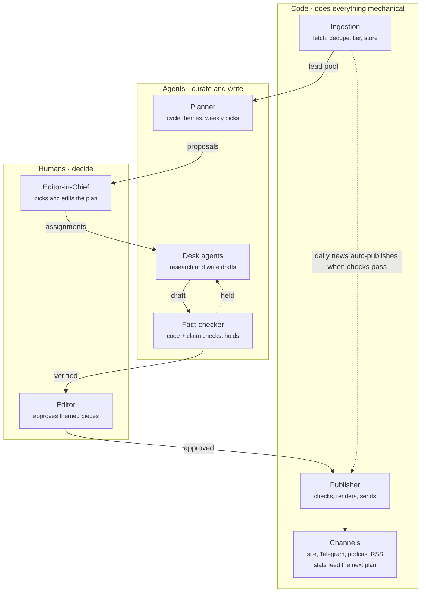

# ANR Charter

Oct 26, 2026 · Mehrad Rousta

## Definition

**ANR (Agentic News Room) is a platform for running publications where humans set the editorial direction, AI agents research and write, and code does everything mechanical.**

It is not tied to one topic or one language. Each newsroom is a tenant with its own topic, languages, policy and channels; the first two are an AI newsroom and a Turkish culture newsroom. This charter fixes what ANR is and is not, so every design and build decision can be checked against it.

## Why ANR

Today's system is a Persian AI news operation: the Telegram channel @singularity_takinegi, an archive site, newsletters and a podcast. It runs as separate agent routines (an hourly digest, a nightly newsletter, a morning classic paper, weekend deep dives and two podcasts), and each routine finds material, writes, formats, sends, records and repairs on its own. That fails in three ways:

- **Cost.** Every run starts by reading a 74 KB rulebook, then spends tokens on work with one right answer: sending to Telegram, deduplicating, scoring credibility, mixing audio.
- **Change.** Rules are enforced by prompt. Every incident adds a paragraph every future run must read, so the rulebook only grows.
- **Direction.** There is no shared plan, theme or editor. Each routine decides alone, every day, from scratch.

ANR replaces it with a new product in a new repo, AgenticNewsRoom, on a new domain. The old system is retired, not migrated.

## What ANR is

ANR is an editorial operating system that runs the full cycle: plan, assign, research, draft, check, approve, publish, measure.

- **Human-directed.** People choose each editorial cycle's theme and the weekly picks, set policy and approve. Agents propose and write; they never set the agenda.
- **Many newsrooms, many languages.** Each newsroom has its own topic, languages, editorial policy, sources, team, domains and channels.
- **Research once, render many times.** A story holds the researched claims and the leads behind them. Renditions write it in a format and a language, and a publication bundles renditions into what goes out in one slot.
- **Source-grounded.** Every factual claim traces back to a lead the system has stored.
- **Formats and channels, not routines.** Newsletters, articles and podcast episodes are formats; a site, a Telegram channel and a podcast feed are channels. A newsroom can run several of each.
- **Openly AI-made.** Every publication and every AI host is disclosed as AI-made, on every channel, in a machine-readable way.

## What ANR is not

Each line is a boundary: a feature request that crosses one needs a change to this charter first.

| ANR is not               | What that means in practice                                                                                      |
| ------------------------ | ---------------------------------------------------------------------------------------------------------------- |
| A content farm           | Nothing is published for volume or SEO. Every publication traces to a plan, a pick or a series a human approved. |
| Autonomous               | Agents propose and write. Humans decide what the newsroom covers.                                                |
| A general CMS            | It renders its own sites from structured publications. No page builder, no WordPress replacement.                |
| A social scheduler       | Channels are outputs of the editorial pipeline, not a calendar of hand-written posts.                            |
| A public news aggregator | The lead pool is internal input for editors, not a reader product.                                               |
| A breaking-news wire     | Speed is measured in hours, not minutes.                                                                         |
| An agent framework       | Agents run on an existing framework (LangGraph.js) as workers on assignments. ANR does not build its own.        |

## Vocabulary

These words mean one thing each, in code, in the data model and in conversation. In prose, "piece" means a publication.

| Term            | Meaning                                                                                                                 |
| --------------- | ----------------------------------------------------------------------------------------------------------------------- |
| Newsroom        | A tenant: topic, languages (one primary), editorial policy, team, domains and channels                                  |
| Beat            | A standing area inside a newsroom, such as labs, research or policy                                                     |
| Source          | Somewhere material comes from: a feed, an API, a site                                                                   |
| Lead            | One stored item from a source, before anyone decides to use it. The lead pool is all of a newsroom's leads              |
| Editorial cycle | A newsroom's planning period, of a length the newsroom sets: theme, angle and calendar                                  |
| Pick            | A weekly choice inside the editorial cycle: the planner proposes three candidates, the Editor-in-Chief picks one        |
| Assignment      | Write this, in this format, for this slot, with this angle and these leads                                              |
| Story           | The researched claims and their leads; format- and language-neutral                                                     |
| Claim           | One fact, quote or opinion in a story, tied to the lead and passage that support it                                     |
| Format          | The shape of a rendition: article, newsletter issue, podcast episode. A schema, templates and checks                    |
| Rendition       | One story written in one format and one language                                                                        |
| Publication     | What goes out in one slot: an article, a newsletter issue or a podcast episode, made of one or more renditions          |
| Series          | A named recurring output with its own identity, such as a specific podcast or newsletter                                |
| Channel         | Where a publication goes out: a site, a Telegram channel, a podcast feed; later email or X. Set up in the editor's desk |

**Roles.** Humans are the Editor-in-Chief and editors, and one platform admin, an operator role with no editorial authority, who chooses which text-to-speech engines newsrooms may use. Agents are the planner, the desk (research and writing), the renderer, the fact-checker, the item matcher and the summariser. Code is the producer and the publisher.

## Architecture direction

Every step has exactly one owner: humans decide, agents curate and write, code does the rest.

Themed work follows the solid path, from the cycle's plan to an approved publication. Daily news takes the dashed path and skips the plan. How each part is built: [Technical design](technical-design.md).

1. **Ingestion is code.** Each source is fetched on its own interval, deduplicated, given a credibility tier and stored in the newsroom's lead pool. A small summariser agent writes the short summaries and places each lead in the newsroom's beats, which carry IPTC subject codes.
2. **Planning is human-led.** At the start of each editorial cycle (its length is set per newsroom) the planner proposes 2–3 themes, each with an angle and a calendar, and the Editor-in-Chief picks and edits one. Each week the planner proposes three candidates for every weekly series, and the Editor-in-Chief picks one. Daily news stays outside the theme; everything else serves it.
3. **Desk agents** receive one assignment with its leads already gathered. They research, write and submit structured JSON: a story, its claims and a rendition. If a source is missing, they ask ingestion to fetch and store it; they never cite anything unstored, and never write HTML, publish or record posts.
4. **Formats are configuration:** a JSON Schema for the draft, templates per channel kind, code checks and a short writing guide.
5. **Publishing is code only.** The publisher renders approved publications from templates, sends them to their channels and records each post as part of sending, idempotently. For a podcast, an agent writes the script; code does the voices, mixing, upload and feed.
6. **Tenancy.** A new newsroom is configuration (sources, series, style guide and credibility policy) plus channels set up in the editor's desk. Every tenant table carries the newsroom id.

## Editorial safeguards

Four safeguards are part of the platform, not optional settings. The first three come from newsrooms already running on AI agents.

1. **A verifier gate that can hold publication.** Code checks each draft's structure, quotes and sources. A fact-checker on a different model from the writer then checks each factual claim once against its stored lead, and every language's text is checked against those claims. Each claim needs two independent sources, or one tier-1 source; a beat can require more. The gate can hold a publication but never approve one: a failed, unclear or broken check sends it to a human. The writer never checks its own facts.
2. **Banned and restricted beats.** Each newsroom's policy lists beats it never covers and beats that always need human review. A culture newsroom might restrict artists' political statements and ban their private lives.
3. **Corrections and challenges.** Readers can challenge a publication. A named human owns each newsroom's corrections: the challenge is acknowledged within 24 hours and answered within 48 hours. Every correction is published and becomes a new check.
4. **AI disclosure.** Mandatory on every channel. Publications carry a visible label and machine-readable metadata (IPTC Digital Source Type, and C2PA for media).

## v1 scope

**v1 is done when a second newsroom starts from configuration alone, with no new code.**

v1 runs two newsrooms: the AI newsroom in Persian and English, and Kültür, a Turkish culture newsroom in Turkish, English and Persian that proves the test. Their plans and configs: [First newsrooms](first-newsrooms.md).

| Area          | In v1                                                                                                                            |
| ------------- | -------------------------------------------------------------------------------------------------------------------------------- |
| Formats       | Newsletter issue, classic article, artist story, podcast episode; each story rendered in one or more languages                   |
| Channels      | Website on its own subdomain, Telegram, podcast RSS; each newsroom sets up its own in the editor's desk                          |
| Planning      | Editorial cycles of any length and weekly picks, with agent proposals and human approval                                            |
| Editor's desk | Where editors sign in, approve plans and picks, review drafts, manage channels and handle corrections                            |
| Safeguards    | All four above                                                                                                                   |
| Measures      | Hold rate, sample misses, corrections per 100 publications, editor minutes per week, cost per publication, audience per language |

Later, not in v1: email newsletters, more social channels, video, and opening ANR to other publishers (billing, onboarding, external auth).

## Decisions

All decisions below are settled. The full log, including technical decisions, is in [Decisions](decisions.md).

| Decision            | Detail                                                                                                                                                                                   |
| ------------------- | ---------------------------------------------------------------------------------------------------------------------------------------------------------------------------------------- |
| Audience            | Our own newsrooms first. The data model is multi-tenant; v1 has no billing, onboarding or external auth.                                                                                 |
| AI disclosure       | Platform-wide and mandatory, part of ANR's identity, never a per-newsroom setting.                                                                                                       |
| Old system          | Retired. ANR starts fresh in a new repo on a new domain; nothing is migrated.                                                                                                            |
| Publishing boundary | Only code sends to channels. Agents do curation and editorial work only.                                                                                                                 |
| Approval            | Themed publications wait for an editor. From day one, daily news publishes on its own when no check holds it; editors review a 10% sample afterwards, and each miss becomes a new check. |
| Agent runtime       | Agents run as LangGraph.js graphs that the platform triggers, calling models through a router (Gemini by default), not as scheduled coding-agent sessions.                               |
| Planning            | The planner proposes 2–3 themes per editorial cycle and three weekly candidates per series; the Editor-in-Chief picks and edits.                                                                     |
| Language            | Several languages per newsroom, with right-to-left Persian first-class from day one.                                                                                                     |
| People              | Mehrad Rousta is Editor-in-Chief and corrections owner of both first newsrooms.                                                                                                          |
| Reader challenges   | Acknowledged within 24 hours, answered within 48 hours, by the newsroom's corrections owner.                                                                                             |
| Name and domain     | The product is ANR (Agentic News Room). The root domain is a deployment setting (`ANR_ROOT_DOMAIN`); each newsroom lives on its own subdomain and the editor's desk on `desk.`.          |

## Prior art

No open platform runs plan, assign, write, approve and publish across several newsrooms. ANR's new parts are human-directed editorial planning and tenancy; the rest has working examples to learn from.

**AI-native newsrooms.** These are closed products. The Reuters Institute counts about 30 worldwide.

| Newsroom                | What ANR takes from it                                                                                                                                                                                                                                      |
| ----------------------- | ----------------------------------------------------------------------------------------------------------------------------------------------------------------------------------------------------------------------------------------------------------- |
| Redazione Zero (Italy)  | Closest to ANR. A public editorial charter, separate AI verifiers that can block publication, two independent sources per story, banned and restricted beats, reader challenges answered within 48 hours. Each of its 4 corrections became a new safeguard. |
| Moj Kraj (Croatia)      | Code scores every draft (grammar, tone, neutrality) and holds anything under 80%. About 100 drafts a day, 20–30 published, from 2,000+ sources. An agent checks each source's terms of service.                                                             |
| Tucson Daily Brief (US) | Routine items publish automatically; high-stakes ones get human review. One story becomes a podcast, a TikTok and a search answer.                                                                                                                          |
| Journal Métro (Canada)  | One human editor approves every AI draft. Every article is labeled as AI- or human-written.                                                                                                                                                                 |
| RuntimeWire (US)        | Holds a story when its attribution is thin.                                                                                                                                                                                                                 |
| Il Foglio AI, A47 Media | Warnings. The first needed human fixes for plagiarism and false stories. The second sells stories at $0.20 each with no editor: the content-farm model ANR rejects.                                                                                         |

**Open-source parts.**

| Project                                       | Use in ANR                                                                                                                                                  |
| --------------------------------------------- | ----------------------------------------------------------------------------------------------------------------------------------------------------------- |
| Superdesk (Sourcefabric)                      | Reference for the domain model: planning, editorial calendar, assignments. Used as a reference only; ANR does not run it.                                   |
| STORM / Co-STORM (Stanford), GPT Researcher   | Outline-then-write patterns for the research step. Their open web search becomes a request to ingestion, so every cited source is stored.                   |
| Loki / OpenFactVerification                   | A staged fact-checking pipeline with swappable models: a base for the verifier gate.                                                                        |
| Open Notebook, Podcastfy, NotebookLlama       | Podcast generation.                                                                                                                                         |
| juhapellotsalo/agentic-newsroom               | Role names and typed handoffs between stages. Avoid two of its choices: the writer checks its own facts, and the Editor-in-Chief is an agent with no human. |
| flyryan/ai-news-aggregator, llm-wiki-newsroom | Patterns only: map-reduce ingestion; writer ≠ reviewer, with a gate that needs both a code check and a review.                                              |

These findings come from a research pass in October 2026.
