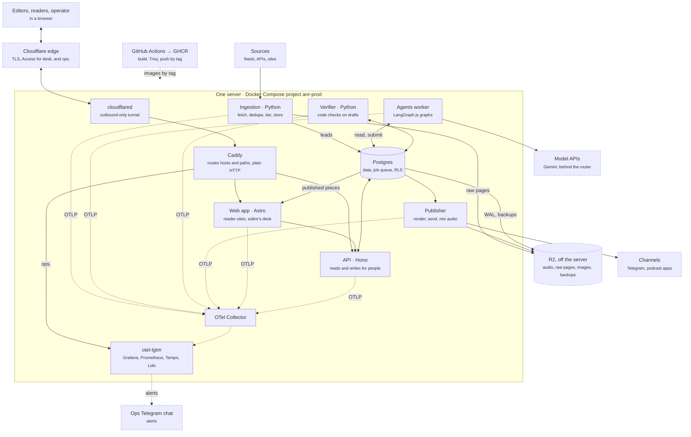
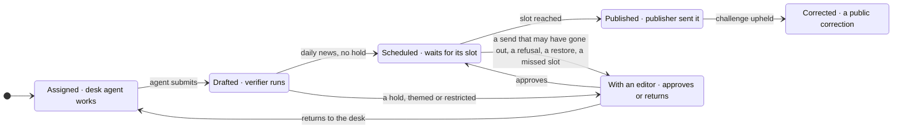
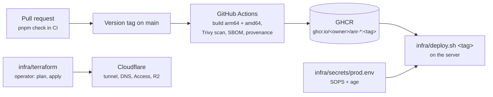
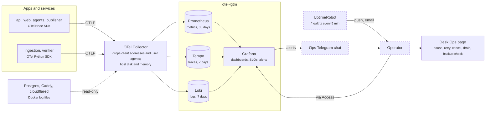

# ANR technical design

Oct 26, 2026 · Mehrad Rousta

ANR v1 runs on one server, a Linux VM or, for ANR's own newsrooms, the operator's laptop: Postgres holds every newsroom's data and the job queue, TypeScript runs the API, sites, publisher and agents, and Python runs ingestion and the verifier. Agents run as LangGraph.js graphs that can read stored sources and submit drafts, and nothing else; where each piece stands lives in Postgres, never in a graph.

## Stack

| Layer                   | Choice                                                                                                                             | Why                                                                                                                                                              |
| ----------------------- | ---------------------------------------------------------------------------------------------------------------------------------- | ---------------------------------------------------------------------------------------------------------------------------------------------------------------- |
| Host | One server with Docker Compose: a Linux VM, or the operator's laptop (macOS); host-specific parts are a host profile; Caddy routes hosts and paths inside it | One machine fits one operator and a few newsrooms; ANR's own runs at no hosting cost |
| DNS and TLS             | Cloudflare DNS for the root domain; Caddy (custom build with the Cloudflare DNS module) issues one wildcard certificate via DNS-01 | Newsrooms are added without touching TLS|
| Database                | Postgres 17, row-level security on `newsroom_id`                                                                                   | Tenancy enforced by the database, not by each query                                                                                                              |
| Migrations              | Plain SQL applied with dbmate                                                                                                      | Language-neutral, and row-level-security policies are SQL anyway                                                                                                 |
| Jobs                    | pg-boss on the same Postgres; its schema installed by a migration                                                                  | Cron, retries and singleton keys with nothing new to run                                                                                                         |
| API                     | TypeScript, Hono on Node, OpenAPI contract written first                                                                           | Same tools as the current API                                                                                                                                    |
| Sites and editor's desk | Astro, server-rendered on Node; one app routes by host, and text direction follows each page's language                            | Reader sites read Postgres live, so publishing needs no rebuild                                                                                                  |
| Desk sign-in            | Cloudflare Access in front of `desk.$ANR_ROOT_DOMAIN`; the app verifies the Access JWT and maps the email to a membership          | No passwords or sign-in code in ANR                                                                                                                              |
| Site search             | Postgres `pg_trgm` over text normalised by the SQL function `anr.normalize_text()`                                                 | Works for Persian and Turkish without a stemmer or another service                                                                                               |
| Agents                  | LangGraph.js graphs in one agents worker; Gemini models behind a model router and a fallback gateway (`@anr/models`)              | Explicit, testable steps; works across model vendors; an agent can use only the tools ANR writes for it                                                          |
| Ingestion               | Python service: httpx, feedparser, trafilatura                                                                                     | Python's feed and text-extraction libraries are the strongest                                                                                                    |
| Verifier                | Python service: the code checks, such as quote matching and source independence                                                    | Text matching and NLP libraries                                                                                                                                  |
| Templates               | LiquidJS, one template per format and channel kind                                                                                 | Logic-less, safe to keep in config                                                                                                                               |
| Audio                   | Inside the publisher worker: ffmpeg, and Gemini TTS with one job per segment                                                       | The current podcast pipeline, ported                                                                                                                             |
| Media and backups       | Cloudflare R2 (S3-compatible object storage) off the server                                                                           | Audio, raw source snapshots, and Postgres backups (continuous WAL archive with pgBackRest), so losing the server loses nothing; no egress fees for podcast downloads |
| Shared schemas          | JSON Schema as the source; zod and pydantic generated from it                                                                      | Format schemas are read by both languages                                                                                                                        |
| Releases | GitHub Actions builds multi-arch images, scans them with Trivy and pushes them to GHCR; the server deploys by tag; Renovate keeps dependencies current | What was scanned is what runs; rollback is an older tag |
| Edge as code | Terraform for Cloudflare: tunnel, DNS, Access, R2 buckets | Reviewed, reproducible edge configuration |
| Production secrets | SOPS with age: the production `.env` committed encrypted | Versioned settings without plaintext secrets in git |
| Observability | OpenTelemetry in every app; an OTel Collector; Grafana LGTM (`grafana/otel-lgtm`: Grafana, Prometheus, Tempo, Loki) | One vendor-neutral standard for traces, metrics and logs across both languages |
| Repo                    | One monorepo: pnpm workspaces and Turborepo for TypeScript, a uv workspace for Python                                              | One `pnpm check` covers both languages                                                                                                                           |

The Python services expose internal HTTP endpoints; TypeScript jobs call them, so there is only one queue.

## Components



Services never call each other's data directly: each reads and writes Postgres, and pg-boss jobs in the same database move work along. Agents reach Postgres only through their four tools. Readers and editors reach the server only through Cloudflare and the tunnel; telemetry flows one way, to the collector.

## Data model

Every tenant row carries `newsroom_id`, enforced by row-level security (see Tenancy), and references other tenant rows through composite foreign keys on `(newsroom_id, id)`, so no row can point into another newsroom. The entities follow the charter's vocabulary; Check, Post, Media, User and Membership, Agent run, Audit log and the audience counters are added here. Tables are named in the plural (`publications`, `checks`). A lead's stored text and the audit log cannot be changed once written; triggers refuse it.

| Entity                            | Key fields                                                                                | Notes                                                                                                          |
| --------------------------------- | ----------------------------------------------------------------------------------------- | -------------------------------------------------------------------------------------------------------------- |
| Newsroom                          | slug, languages (one primary), timezone, subdomain, policy                                | The tenant. Policy holds beats, source rules and tiers                                                         |
| User, Membership                  | user (email); membership = user, newsroom, role (Editor-in-Chief or editor)               | Who can sign in to the desk and approve. Every approval and edit goes to the audit log                         |
| Platform setting                  | key, value, updated by; the platform audit log                                            | Above every newsroom: the TTS engines the one platform admin enabled (D113)                                    |
| Newsroom TTS                      | newsroom, language, engine                                                                | The engine a newsroom's episodes in a language are voiced with, chosen by its Editor-in-Chief (D113)           |
| Audit log                         | actor, action, entity, before, after, at                                                  | Also tells the publisher whether an editor changed a publication's text                                        |
| Channel                           | kind (site, Telegram, podcast feed), language, external id, encrypted credentials, status | Data, not config: set up in the editor's desk and stored in Postgres                                           |
| Beat                              | name, status: open, restricted or banned, IPTC Media Topics                               | Restricted beats always go to a human; banned ones are never assigned. The topics classify every lead and publication in the beat |
| Source                            | kind (RSS, API, site), url, publisher, tier 1–3, fetch interval, terms checked (date)     | Tier 1 = primary: a lab's own post, a filing, an artist's or label's own statement                             |
| Lead                              | source, canonical url (ninjs `uri`), headline, stored text (`body`), language, byline (`by`), first and version created, content hash, SimHash, raw page key, links, tier, summary, beats, requested by (agent run), fetched at, withdrawn (at, reason) | The lead pool. Claims cite the stored snapshot (text, hash, SimHash and raw page are frozen). A lead an agent requests from an unknown site gets tier 3. A lead later found withdrawn keeps its text and is skipped by search, assignments and the verifier (D78) |
| Lead sighting                     | lead, uri, source, match (original, same URI, same text, near-duplicate)                  | Every place a lead was seen; a syndicated copy is a sighting, never a second lead or a second independent source |
| Source fetch state                | source, ETag, Last-Modified, last fetch, status, error, consecutive failures              | Ingestion's own state, apart from the config-synced source row                                               |
| Source request                    | agent run, uri, requested at                                                              | One fetch an agent run asked ingestion for; the per-run cap counts these (D61)                               |
| Editorial cycle                   | starts, ends, theme, angle, calendar (a focus per week), rationale, leads, status, decided by | The planner's 2–3 proposals per cycle; the Editor-in-Chief approves one, edited, and the rest are declined (D105). The period comes from `planning` in `newsroom.yaml` |
| Pick                              | cycle, series, week, slot, three candidates (each with its leads), chosen, picked by, deadline, skipped | The weekly choice. With no pick by the deadline, that week's slot is skipped and the editor is told (D104) |
| Assignment                        | cycle or pick (empty for daily news), series, slot, angle, leads                          | The unit of work an agent receives                                                                             |
| Story                             | assignment, summary, beat                                                                 | Format- and language-neutral; researched once                                                                  |
| Claim                             | story, ref (c1, c2…), kind (fact, quote or opinion), text, lead, quoted passage; further sources (lead, passage) | Fact-checked once per source, however many languages the story appears in. Written in its lead's language (D77); further sources corroborate it (D74) |
| Rendition                         | story, format, language, structured body                                                  | Each item in the body lists the claim ids it relies on                                                         |
| Publication                       | series, slot, language, status, ordered renditions                                        | What goes out in one slot: an article, a newsletter issue or a podcast episode. The lifecycle below runs on it |
| Check                             | claim or rendition item, kind (code, fact-check, item match, policy, correction), result, detail              | Every check is stored, so a hold always has a reason                                                           |
| Post                              | publication, channel, part, external id, idempotency key, sent at, dry run                | `part` numbers the messages of a split Telegram post                                                           |
| Media                             | file, source page, lead, IPTC Photo Metadata: creator, credit line, copyright notice, web statement of rights, licensor, digital source type, description; licence: kind (press kit or Commons), terms, URL, who recorded it; the publisher's copy | Added by a member; a recorded licence never changes. The publisher refuses media without a licence and a credit |
| Challenge, Correction             | challenge: publication, reader text, source, owner, acknowledge by, answer by, token hash, rate key, acknowledgement, answer, outcome, issue; correction: publication, challenge, check, notice, published at | Nothing about the reader is stored (D114). A correction links the `correction` check on the claim that was wrong (D115, D116) |
| Agent run                         | role, model, every family that answered, prompt version, input hash, tokens, cost, outcome, detail | Every model call is logged with its cost, TTS included; tokens and cost are summed over a run's calls. The fact-checker avoids every family of the story's desk and renderer runs |
| Notice                            | kind (budget, no leads, no channel, no theme, pick missed, plan failed, challenge due or overdue, media failed, slot missed), key, detail, read at                          | A message from code to the Editor-in-Chief, once per period, shown in the editor's desk                        |
| Heartbeat, Outage                 | worker, last beat; outage: kind (worker or host), worker, start, end                     | Platform tables: a gap over 3 minutes is an outage (D128) |
| Backup run, Ops request           | kind, start, finish, result, detail, request; request: kind, by, picked, done            | Platform tables written by the host's backup job (D131, D144) |
| Publishing pause, Queue drain     | pause: newsroom, by, at; drain: queue, by, at                                            | A newsroom's pause is a tenant row; drains are platform rows; pausing everywhere is a platform setting (D144) |
| Page view, Download, Channel stat | publication or channel, language, day, count                                              | Audience per language (see Measures)                                                                           |

Format and Series are configuration, versioned in the repo. Channels, users and memberships are data, managed in the editor's desk.

## Publication lifecycle



Each box is a value of a publication's `status`. A publication exists from the moment its assignment is made, so it starts as Assigned. Each arrow is a pg-boss job or an editor's action. An assignment whose agent fails validation twice also goes to an editor, and so does any publication still Assigned or Drafted 30 minutes before its slot (D80).

## Ingestion

Each source has its own pg-boss schedule, for example hourly for lab blogs and every 6 hours for arXiv. A source is scheduled only once a person has read its terms and set `terms_checked` in `sources.yaml`. A run calls the Python ingestion service, which turns new items into stored leads in this order:

1. **Fetch** the feed, API or page.
2. **Extract** the main text, and keep the raw page in object storage. The item's headline, byline, language and dates are kept under their ninjs names. For an image a member added at the desk (`POST /media`, D119), the IPTC Photo Metadata embedded in its XMP is read into the Media row, and a free Wikimedia Commons licence is read from the Commons API.
3. **Deduplicate** by canonical URL, then content hash, then near-duplicate text (SimHash candidates confirmed by shingle overlap, D56), so a syndicated copy joins the original's lead as a sighting and never counts as a second source.
4. **Tier.** Other leads take their source's tier. arXiv papers follow the paper tier rules (D59), mapped onto tiers: high is tier 1, medium tier 2, low tier 3, and flagged papers are dropped. High needs Semantic Scholar's venue or citations, never the authors' own claim; preprints are medium.
5. **Store** the lead with its text. The text is frozen: claims quote this snapshot, never the live page.
6. **Summarise and classify** with the summariser agent: a short summary, and the newsroom beats the lead belongs to. A lead's IPTC subjects are its beats' Media Topics, so classification never invents a code.

When a desk agent requests a source, it runs through the same steps at once, and the agent gets the lead back (D61). Each arXiv run also asks arXiv for its record of the source's papers of the last 30 days and marks any it now calls withdrawn (D78).

Every fetch goes through one guarded client (D58): http and https only, every address public and checked at connect time, robots.txt honoured for pages (an API source follows its API terms instead, D64), a polite delay per host, conditional GET. Hacker News items are stored as metadata only (D60). The TypeScript `ingest-source` job and the Python service share one contract, the JSON Schemas `ingest-*` and `source-request*` in `packages/schemas` (D62).

## Agent runs

Each agent run is one pg-boss job that runs one LangGraph.js graph and ends with one submit. A graph never waits for a human: approvals, holds and schedules are rows in Postgres.

| Role         | Runs when                                                                      | Gets                                                                                         | Steps                                                       | Submits                                                                        | Default model                                                          |
| ------------ | ------------------------------------------------------------------------------ | -------------------------------------------------------------------------------------------- | ----------------------------------------------------------- | ------------------------------------------------------------------------------ | ---------------------------------------------------------------------- |
| Planner      | The daily planning tick: a week before a cycle starts, for themes; in each weekly series' pick window, for candidates (D103) | The last cycle's stats, lead pool trends, policy; for candidates, the approved theme and the week's focus | Review stats → find themes or candidates → write proposals  | 2–3 themes with angle and calendar, or three candidates for a weekly series, each resting on stored leads | Gemini Pro                                                             |
| Desk         | An assignment's slot comes up                                                  | Assignment, format schema, style guide, stored text of its leads                             | Read → outline → draft → list claims with quotes → validate | Story, claims and the first rendition, as JSON                                 | Gemini Pro; Gemini Flash for newsletter issues                         |
| Renderer     | A story needs another format or language, or a podcast needs the week's script | The story and its claims, or the week's published renditions; the target format and language | Draft → validate                                            | One more rendition, items linked to claims; no new research                    | Gemini Flash                                                           |
| Fact-checker | A story's claims pass the code checks                                          | One fact claim and its quoted passage at a time                                              | Check each claim                                            | A verdict per claim: supported, partial or unsupported                         | Gemini Flash for stories Pro wrote; Gemini Pro for stories Flash wrote |
| Item matcher | A rendition passes the code checks                                             | One rendition item and the claims it lists                                                   | Compare                                                     | Match, or what the item says beyond its claims                                 | Gemini Flash                                                           |
| Summariser   | A new lead is stored                                                           | The lead's text                                                                              | One call                                                    | Short summary and the lead's beats                                             | Gemini Flash-Lite                                                      |

**Tools.** An agent can do only four things: read a lead, search its newsroom's lead pool (trigram word similarity over normalised text, D73), request a new source (ingestion fetches and stores it, then returns the lead), and submit. Source requests are capped per run, private and internal addresses are refused, and a lead from an unknown site gets tier 3, so an injected page cannot promote itself. It has no web access, no send and no other writes. Models are bound to the three research tools; code calls submit once a draft validates, in one transaction with the run's outcome and the jobs that follow.

**Planning.** A `plan` job runs every morning in each newsroom's timezone and starts the planner runs that are due, each once (D103). The planner's submit stores the proposals; for a pick it also queues a `pick-deadline` job for the deadline, so nothing waits for the Editor-in-Chief. A choice made in time in the desk queues the slot's assignment, from the chosen candidate's angle and leads, in the pick's cycle (D104).

**Daily news.** At a daily series' `assignment_at` (16:00 for the AI newsletter), code assigns that evening's slot the last 24 hours of summarised leads, best tier first, with one publication per language and a desk run (D81). The desk writes the story and its first rendition in the newsroom's primary language; a renderer run writes each other language from the story's claims (D77); then the gate runs.

**Model router.** Agents name a role, never a model. A router in the agents worker maps each role to an ordered chain of models from the catalog in `config/models.yaml`, and a newsroom can override it. Changing a model or vendor is a config change; the defaults in the table are Gemini. Each catalog model has a `family`, the weights whoever serves them. The fact-checker's chain drops every family that wrote the story, read from the desk and renderer Agent runs of the story and of every story its claims were copied from (an episode's, D107); config validation requires at least two families in it, so the writer never checks its own facts, even when another provider serves the same weights.

**Model gateway.** `@anr/models` calls a chain in order and records which model answered. A rate limit (429, quota), an outage (5xx, timeout), a retired model or a request too large for one model (413, D83) moves the call to the next model; a rate-limited model cools down for as long as the provider says (`Retry-After`, `x-ratelimit-reset-*`, Gemini's `RetryInfo`) or backs off from 1 minute to 1 hour (longer than the provider's hint when 429s repeat); a provider whose quota is per account (`shared_quota`) cools down as a whole; every call has a 120-second deadline (a provider's `timeout_s` may extend it) and writes at most 8,192 tokens, with a per-model `reasoning_effort` for OpenAI-compatible providers (D85); and published limits in the catalog stop calls before the provider refuses them. A bad key or a bad request fails at once. When the chain is exhausted the run ends as an error, so the publication is held. A run keeps the model that first answered unless it fails. For development, `ANR_MODELS=free` selects `config/models.free.yaml`: local models served by LM Studio first (D84), then free tiers of Gemini, Groq, OpenRouter, Mistral and NVIDIA NIM; `pnpm models:probe` checks each model with one tool call, and deploy refuses the free profile.

- **Validation.** A submit is checked against the format's JSON Schema, and against what a schema cannot say: cited leads were given or read in the run and are not withdrawn, each passage is in its lead's text, the beat is live, every item lists known claims (D77). An invalid one goes back to the graph once with the errors; a second failure holds the assignment.
- **Prompts.** A role prompt from the platform, plus the newsroom's style guide (its shared section and the target language's) and the format's guide, versioned in config. At most 5 KB in UTF-8 bytes, against today's 74 KB rulebook; the prompt version is a hash of the assembled text (D75). The desk's steps describe the format's own items, read from its schema (D118), and its role prompt allows opinion only as marked opinion where the newsroom's policy does (D117).
- **Budgets.** Each format caps tokens per run (`run_tokens`); each newsroom has a monthly spend cap with a reserve for checks (`budget` in `policy.yaml`). At 80% the Editor-in-Chief is told; at the cap minus the reserve, writing runs do not start while the fact-checker and item matcher may spend the reserve. TTS and summaries count toward the cap; every model needs a price (D76, D82).
- **Logging.** Every run is an Agent run row: role, model, prompt version, tokens and cost, and a trace with a span per graph node and model call (D138).

## Verifier gate

The gate runs in four layers, and two of them use a model. Facts are checked once per story; each language's text is then checked against those facts. Every result is stored as a Check, so a held publication always shows why. A `gate` job per story runs the layers in order once every language is written, storing each result as it comes, so a retry resumes (D80).

1. **Code checks (Python verifier service).**
   - The draft matches its format schema.
   - Every claim names a lead in this newsroom, not withdrawn, and its quote (and each further source's) is found in that lead's stored text. Matching normalises text first: NFKC, zero-width non-joiners, Arabic and Persian ye and kaf, Persian digits, hyphen and minus variants (D86), and Turkish case folding, then collapses whitespace. The same rules back the SQL function used by site search, and both are tested against one shared file of test vectors.
   - Each fact claim has two independent sources, or one tier-1 source. Independent means different publishers, after deduplication, counted over the claim's sources whose passage matched (D74).
   - No banned beat, in the story or any cited lead, and no cited lead not yet placed in beats; a restricted beat is marked for an editor.
   - Every item of every rendition lists its claim ids, and the numbers (and so dates) and Latin-script names in the item are in those claims; names in other scripts are the item matcher's (D79).
   - Every image an item shows is a media item of this newsroom with a licence and a credit (D119).
   - Opinion is marked: where policy allows it, an item citing an opinion claim is marked `opinion: true` and a marked item cites only opinion claims; elsewhere no opinion claim (D117). A claim a person corrected, or one copied from it, fails (D116).
   - The AI-disclosure label is present in every channel template's output, rendered with the publisher's own renderer (`@anr/render`), and so is the opinion label once per marked item (D117) and each shown image's credit (D119); the style lint for the rendition's language and the format's `checks.yaml` rules pass. A rule the verifier does not know is an error.
2. **Fact-checker (agents worker).** Each fact claim and each of its quoted passages go to the fact-checker once, whatever the number of languages, each in a fresh context. It never sees the draft or the writer's reasoning. It returns supported, partial or unsupported. Quotes are matched by code; opinions are labelled, not fact-checked. The model layers run only when every code check passed.
3. **Item matcher (agents worker).** For every rendition in every language, a cheap model checks that each item says no more than the claims it lists. This catches drift between languages.
4. **Policy (code).** Any failed, partial, errored or timed-out check holds the publication for an editor, and so does any check it needs that never ran. Themed publications, restricted beats and formats outside `auto_publish` always go to an editor. Daily news with every check passed is scheduled to publish.

After publishing, code picks a 10% random sample of auto-published publications for an editor to review (D94). Each miss an editor finds is recorded with what should have been caught and filed as an issue that becomes a new code check or a policy rule (D102). An editor decides on a held publication from its own page, which previews exactly what would be sent (D98): approve it (it is scheduled), edit its text first (D97), or return it to the desk for a new draft (D96). A scheduled publication can be pulled back before its slot (D100).

## Publishing

The publisher is a TypeScript worker. When an approved publication's slot comes up, it renders the publication and sends it to each of its channels, then records the post. No agent is involved.

- **Rendering.** Each format has one Liquid template per channel, filled from the rendition's structured body. Templates mark where a long post may split (blank lines); `@anr/render` splits to the channel's limit, such as Telegram's 4,096 characters, with the disclosure label on every message (D88).
- **Idempotent send.** Before calling a channel, the publisher writes a Post row keyed on publication, channel and part, with the text of that part, and marks the moment it starts the call. After the call it stores the channel's message id. A retry that finds a stored id skips the send. A send whose result is unknown, or one interrupted mid-call, is held for a human rather than sent twice; a refusal is retried only when it is a rate limit or an unreachable channel (D89). The site goes live last. After a database restore (`restores`, written by `infra/backup/restore.sh`), every slot already past due is held too, so nothing goes out again (D90). A send starts only while its slot is at most its format's `grace` old; a later one is held as a missed slot and the editor is told (D129). Sending to an external channel needs `ANR_PUBLISH=live`, set only in production (D126). A channel kind a series names but the newsroom has not set up is skipped with a notice (D91).
- **Reader site.** The web app reads published and corrected publications from Postgres as the app role. A piece's page is `/<series>/<slot date>` under its language (D92), its body is the format's `site` template, and its ninjs twin is the page URL plus `.json`. Site search ranks pieces by trigram word similarity over `anr.normalize_text()` of their text. Page views are counted per publication and day, with no cookie and nothing stored about the reader.
- **Channels in v1.**
  - Site: the piece's status becomes published, and the server-rendered site shows it at once.
  - Telegram: the Bot API, for newsrooms that have a Telegram channel.
  - Podcast RSS: sending stores the episode's `<item>` as its Post, and the site serves each language's feed from those Posts at `/podcast/<series>.xml` (D110).
- **Podcast script.** At the series' `assignment_at`, code builds the episode's own story from copies of the claims of the week's published stories; a renderer run per language writes the script as JSON, one part per call (D107). Each recap topic and story beat lists the claims its lines rely on. Code opens every episode with each host and the narrator saying they are AI voices (`_partials/ai-voices.liquid`), and the gate checks it. A news-recap segment is a conversation of host lines. A story segment is told as a narrative:
  - **Protagonists:** one to three people the story follows, each grounded in claims.
  - **Beats:** cold open, context, turning point, stakes, resolution, takeaway, each exactly once in that order (stakes and turning point may swap). The turning point and resolution name a protagonist.
  - **Narrator:** a third AI voice for scene-setting and transitions, alongside the hosts.
  - **Delivery directions:** an optional short hint per line, such as "hushed", passed to TTS as a style prompt.
  - **Sound cues:** sting, bed swell, bed out, pause or transition, mapped to the series' stock assets.
  Sources are paraphrased and attributed in speech, never read aloud as quotes. The verifier checks the arc, the protagonists' claims, and that cues and directions stay sparse.
- **Podcast audio.** Code then runs the current pipeline:
  1. Once the script is approved, a `podcast-audio` job voices it, with voices set per host, narrator and language in the series config and delivery directions as style prompts, cached by text, voice and direction (D109). Gemini TTS takes a segment's lines in as few requests as two voices per request allow (D112); a local engine takes a line at a time.
  2. ffmpeg mix: jingles, a ducked music bed, the script's sound cues mapped to the series' stock assets (synthesised and owned, D108), and loudness normalised to −16 LUFS in two passes, encoded as MP3. Episodes contain no recorded-music clips.
  3. ID3 tags and a chapter per topic and story, then the C2PA signature.
  4. Store the file: a local directory until milestone 7a, then object storage.
  5. At the slot, if audio made after the last approval exists: add the feed item, and send the episode to Telegram where the newsroom has a channel there; else wait until the format's grace has passed, then hold (D129).
- **Challenges and corrections.** Every piece ends with a reader's challenge form; the site passes it to the API's public challenge route, which stores it with its owner (the newsroom's corrections owner), its 24- and 48-hour deadlines and four `challenge-deadline` jobs that remind the desk before each deadline and say when one passed. Nothing about the reader is stored; they follow the answer on a status page their link opens (D114). An editor acknowledges and answers at the desk. Upholding names the wrong claim: a `correction` check fails its original, so the gate refuses it and every copy, and each published piece holding it gets a notice in its language, which a `publish-correction` job puts on the site and marks the piece Corrected (D115, D116).
- **Media.** v1 publishes images only with a recorded licence: an artist's or label's press kit that allows press use, recorded by a person at the desk, or a free Wikimedia Commons licence (CC0, public domain, CC BY, CC BY-SA), recorded by code; always with credit (D16, D119). A member adds an image by URL with the lead it goes with; the desk agent sees a lead's licensed images and may set an item's `media_id`, and code writes the alt text, credit and licence from the Media row. Before sending, the publisher holds a publication whose images lack a licence or a credit, never dropping the image. Each image is published once at `/m/<id>.<ext>`: exiftool writes the Photo Metadata and licence into a copy's XMP, then c2patool signs it with the untouched source as parent ingredient (D120).

## Tenancy and configuration

A newsroom is a folder of config in the repo plus its channels, which live in the database. Adding one is a pull request and its channels set up in the editor's desk, which is exactly the v1 test; the wildcard DNS record already covers its subdomain (D122).

```
config/
  models.yaml                providers, model catalog, role → chain of models
  models.free.yaml           the same for free tiers (ANR_MODELS=free, development only)
  formats/<format>/          shared by all newsrooms
    schema.json              the draft's JSON Schema
    templates/<channel>.liquid   one template per channel kind
    checks.yaml              format-specific code checks
    format.yaml              IPTC genre, ninjs type, tokens per agent run
    guide.md                 short writing guide for the agent
  formats/_partials/         partials shared by all templates, the disclosure label among them
  newsrooms/<slug>/
    newsroom.yaml            languages, timezone, subdomain, Editor-in-Chief, corrections owner, planning cycle
    policy.yaml              beats with their status and IPTC Media Topics, source rules, tiers, auto-publish, monthly budget
    sources.yaml             sources with kind, url, publisher, tier, interval and terms checked
    series/<series>.yaml     a named recurring output: format, languages, cadence, hosts, channel kinds
    style.md                 the newsroom's style guide, per language
```

- **Domains.** Every newsroom site is served at `<subdomain>.$ANR_ROOT_DOMAIN`, its primary language at `/` and other languages at `/<language>`. The editor's desk is at `desk.$ANR_ROOT_DOMAIN` and Grafana at `ops.$ANR_ROOT_DOMAIN`; config validation keeps both names from newsrooms (D123).
- **Channels.** Channels are data, not config or environment. The Editor-in-Chief adds a site, Telegram channel or podcast feed in the editor's desk, per language. Credentials such as bot tokens are encrypted in Postgres with one platform key. A series names channel kinds and languages; the publisher looks up the matching channels at send time.
- **Environment.** The only secrets in the environment are the platform key, the Postgres passwords (superuser and the three roles), object storage keys, the backup encryption passphrase, the model API keys, the Cloudflare Tunnel token and the ops Telegram bot's token (D124). Database URLs are built from the passwords. `.env.example` lists them; in production their values are stored SOPS-encrypted in `infra/secrets/prod.env` (D125).
- **Platform admin.** One user may be the platform admin, named by the operator with `desk:admin`; they enable the TTS engines newsrooms may choose, on the desk's Admin page (D113), and use the Ops page's controls, none of which can approve, publish or suppress anything (D144).
- **People.** Editors sign in to the desk through Cloudflare Access; the API verifies the Access JWT on every request and maps the email to a membership (D95); the operator grants the first one with `desk:grant`. Each membership gives a role in one newsroom, and every approval and edit is written to the audit log, as is opening a held publication (for editor minutes, D99). The desk also shows upcoming slots, the month's budget and spend by role, source health, and the measures below; the Editor-in-Chief tests channels and replaces their tokens there (D101). `newsroom.yaml` names the publicly accountable Editor-in-Chief and corrections owner, shown on the newsroom's corrections page.
- **Loading.** Config ships inside the release images, so a config change, a new newsroom included, goes out as a new tag (D134). It is validated in CI and synced to Postgres at deploy, with stable ids; removed items are soft-deleted, and pg-boss schedules are reconciled in each newsroom's timezone.
- **Isolation.** Each transaction sets the current newsroom with a transaction-local setting, so a pooled connection never carries it to the next request; a query with no newsroom set fails rather than returning rows. A migration role owns the tables and is under forced row-level security too; the app role is under forced row-level security, with check policies on writes. Config sync, which spans newsrooms, and the operator's `desk:grant` and `desk:admin`, which add the first membership and the platform admin before anyone can sign in, run under a separate system role; the gate's and the publisher's sweeps list newsrooms and work inside each one's setting as the app role (D93). CI fails if a tenant table has no policy.
- **Credentials.** A channel's credentials are sealed in the app with envelope encryption: a random data key per credential under AES-256-GCM, wrapped by the platform key and bound to the channel's newsroom and id.
- **Overrides.** A newsroom can override a format's templates or guide in its own folder, but not its schema or its checks.

## Deploy and backups

Production is one server: a Linux VM, or the operator's laptop (D145). Prod is the Compose project `anr-prod` (its own volumes, Postgres on `127.0.0.1:5433`, no other published port); where dev shares the machine, as on the laptop, it is project `anr` on 5432. What depends on the host is a profile in `infra/host/`: `linux` (systemd, the reference) or `macos` (launchd, keep-awake) (D127). Only prod sends to real channels (`ANR_PUBLISH=live`, D126). Nothing is deployed before milestone 6's gate passes (D53); milestone 7a deploys and 7b adds observability.



- **Reachability.** A `cloudflared` container holds an outbound-only tunnel; Cloudflare terminates TLS and Access guards `desk.` and `ops.` (D122, D123). The tunnel sends every host to Caddy, which routes `ops.` to Grafana, `/api/*` on `desk.` to the API and the rest to the web app. The root and a wildcard record point at the tunnel, so a newsroom's subdomain needs nothing at Cloudflare.
- **Edge as code.** `infra/terraform/` declares the tunnel, DNS records, Access applications and policies, and R2 buckets. The operator runs `plan` and `apply`; state is in a private R2 bucket made by hand, locked, and treated as a secret (D136).
- **Releases.** A version tag builds every image for arm64 and amd64, scans it with Trivy, attaches an SBOM and provenance and pushes it to GHCR (D134). `config/` is inside the image. Renovate proposes dependency updates (D135).
- **Deploying.** `infra/deploy.sh <tag>` decrypts `infra/secrets/prod.env` with the operator's age key (D125), refuses unsafe settings, pulls the tag's images, applies the role passwords, checks that WAL reaches R2 and starts the prod profile: migrations (as the migration role), then config sync (as the system role, after the tenancy check), then the apps, cloudflared, Caddy and the telemetry stack. Rolling back is deploying an older tag; migrations are expand-then-contract so the previous tag still runs, and anything else is a restore (D134). `--check` checks only, and also refuses a host disk under 10% free and, on macOS, warns when sleep is on for AC power (D127, D132).
- **Backups.** pgBackRest archives WAL to R2 at least every 5 minutes, takes a weekly full and a daily differential backup, keeps four full backups and encrypts them with a passphrase held outside the server (D51). The host's scheduler (systemd timers on Linux, launchd on macOS) runs the schedule and a check every 30 minutes, and runs a job missed while the host was down once when it is back (D131); each result is a `backup_runs` row. A restore goes into an empty volume and runs with archiving off. `infra/backup/restore-drill.sh` restores the latest backup onto a fresh machine and loads config into it, and `infra/backup/drill-local.sh` rehearses the whole cycle locally.
- **Storage.** Raw pages, episode audio and published images are in private R2 buckets; the site's `/a/` and `/m/` links redirect to presigned URLs (D132). The server keeps Postgres, WAL waiting to archive and telemetry.
- **Gaps.** A server goes away sometimes: a reboot, a paused or migrated VM, a laptop asleep (the macOS profile keeps it awake on AC power, D127). Every gap is recorded as an outage (D128); when the server is back, each schedule runs once for its latest period, deadline jobs fire once, and sweeps do not replay (D130). A send whose slot is more than its format's grace old is held for a person (D129). The tunnel reconnects and WAL archiving retries by themselves.

| When the server is back after a gap       | What happens                                                                                   |
| ----------------------------------------- | ---------------------------------------------------------------------------------------------- |
| `publish-sweep`                           | Runs once. Sends a slot within its grace; holds a later one as `missed-slot` with a notice (D129) |
| Daily assignment (D81)                    | Runs once if its slot has not passed; otherwise a `slot-missed` notice                          |
| Gate deadline sweep (D80)                 | Runs once; publications still assigned or drafted 30 minutes before their slot are held       |
| Planning tick (D103)                      | Runs once for the day                                                                          |
| `pick-deadline` (D104)                    | Fires once: if the pick is still unchosen, it is skipped with a `pick-missed` notice             |
| `challenge-deadline` (D114)               | Fires once; a "due" reminder whose deadline also passed is skipped, so only "overdue" is sent   |
| Podcast audio wait (D110)                 | Ends at the episode's grace, then holds                                                        |
| Ingestion                                 | Each source's next run fetches what it missed                                                  |
| Backups (D131)                            | The host's scheduler runs a missed full, differential or check once                            |
| Restores (D90)                            | Unchanged: a slot at or before a restore is held, whatever the gap                             |

## Operations and observability

Every app emits OpenTelemetry; Grafana shows it and alerts; the desk's Ops page is where the operator acts. Grafana is for looking, the desk for acting (D144).



- **Signals.** The Node SDK instruments Hono, Astro, pg and outgoing HTTP, and every pg-boss job is a span; the Python SDK instruments FastAPI, httpx and psycopg (`packages/telemetry`, D137). Logs are structured JSON with trace and span ids, sent over OTLP, so a log line opens its trace. The collector also reads the Docker log files of Postgres, Caddy and cloudflared, read-only; no container has the Docker socket. Metrics follow OTel's HTTP and database conventions plus ANR's own under `anr.`.
- **Reader privacy.** Telemetry carries no reader data: the collector drops client addresses, user agents, `CF-Connecting-IP` and URL query strings, Caddy writes no access log, and challenge text is never logged (D114).
- **One publication, end to end.** A publication's trace starts at its assignment; its trace id is stored on the publication, and each job for it (desk, renderers, gate, fact-checks, publisher, audio) continues the trace from `traceparent` in its job data. Span links point to the ingest spans of the leads it cites. The publication's page in the desk links to the trace in Grafana.
- **LLM spans.** Each graph run is an `invoke_agent` span, each LangGraph node a child span, each model call a `chat` span with the GenAI conventions' provider, model and token attributes, and each tool call an `execute_tool` span. ANR adds cost (`anr.cost_usd`), the role's chain and every model tried with why it fell through. No prompt or answer text is recorded (D138).
- **Platform gauges.** Every minute the agents worker reports queue depths, held publications and month's spend per newsroom, heartbeat ages, open outages, the latest backup runs and `pg_stat_archiver`. It reads each newsroom inside `withNewsroom()`, so Grafana never touches Postgres (D139).
- **Heartbeats.** Every worker beats every 30 seconds; a gap over 3 minutes is an outage with a start and an end, for one worker or for the whole host (D128). `/healthz` answers 200 only when Postgres answers and every heartbeat is fresh.
- **Backend.** `grafana/otel-lgtm` in one container, pinned, on its own volume, within a 2 GB memory budget shared with the collector (D139). Grafana is at `ops.$ANR_ROOT_DOMAIN` behind Access, for the operator alone, and signs people in from the Access JWT (anonymous access off). Dashboards and alert rules are files in `infra/observability/`.

| Dashboard        | Shows                                                                                         |
| ---------------- | --------------------------------------------------------------------------------------------- |
| Overview         | SLOs and error budgets, open alerts, heartbeats, tunnel connections, the deployed version     |
| Queues           | Depth, age of the oldest job, throughput and failures per pg-boss queue; drained queues        |
| Publishing       | Slots sent, late and missed per newsroom; holds and their reasons; hold rate                  |
| Agents and spend | Runs, tokens and cost per role and model; fallbacks; spend against each newsroom's budget     |
| Backups and disk | Backup runs, WAL archive age and failures, disk free, Postgres size                           |
| Outages          | Worker and host outages over time: sleep, reboots, crashes, restarts                          |
| Load tests       | k6 runs: request rate, latency percentiles, errors                                            |

| SLO (28 days)        | Objective                                                                                              | Alerting                                                   |
| -------------------- | ------------------------------------------------------------------------------------------------------ | ---------------------------------------------------------- |
| Slots on time        | 95% of slots send within their format's grace; a missed-slot hold or a slot an outage left unassigned counts against it | Every missed slot; half the budget spent |
| WAL archived         | In 99.5% of the minutes the server is up, the last archived segment is at most 10 minutes old and no archive attempt failed | Burn rate 14.4× over 1 h and 5 min; 6× over 6 h and 30 min |

Other alerts (D140): a failed backup check or none for an hour; the volumes' disk under 20% and under 10% free; a heartbeat older than 3 minutes; the tunnel with no connection; a hold-rate spike (the last 24 hours over twice the 28-day rate, at least 3 holds). Grafana sends them to the operator's Telegram chat through an ops bot that is not a newsroom Channel. UptimeRobot checks `/healthz` through the tunnel every 5 minutes and alerts the operator by push and email, since a server that is down cannot alert (D141).

- **Ops controls.** The platform admin's Ops page in the desk, next to the Admin page: pause publishing for one newsroom or everywhere; retry a failed job; cancel a job that has not started or drain a queue, only where the work ends in a hold or reruns (never a deadline, a correction, an assignment or a redraft); run a backup check now. Each is a row the workers or the backup agent obey (`platform_settings`, `publishing_pauses`, `queue_drains`, `ops_requests`), and each action is in `platform_audit_log` (D144).
- **Testing it.** k6 load tests in `tools/load/` hit the origin through Caddy, with p95 under 500 ms at 20 requests a second (D142). Chaos drills in `infra/drills/` take the host down across a slot, kill a worker and fill a scratch volume until the low-disk alert fires; each ends in a blameless postmortem in `docs/postmortems/` (D143).

## AI disclosure

Disclosure is built into the templates and checked by code, so no newsroom can turn it off.

| Channel  | Visible label                                                     | Machine-readable                                              |
| -------- | ----------------------------------------------------------------- | ------------------------------------------------------------- |
| Site     | A label on every piece, linking to the newsroom's AI policy       | `digitalSourceType` in the page's schema.org JSON-LD and in its ninjs twin |
| Telegram | A label line in every post template                               | None: Telegram carries no metadata                            |
| Podcast  | AI hosts and the narrator are named as AI in the intro and in each episode's notes | The label in the feed item; a signed C2PA manifest in the MP3 |
| Images   | The credit and licence in the caption, and a label there when the image's recorded source type is AI-made (D119) | IPTC Photo Metadata in XMP and a signed C2PA manifest, both with the image's own recorded digital source type |
- **Source type.** A publication is IPTC `trainedAlgorithmicMedia` ("Created using Generative AI"). Once the audit log shows an editor changed its text, it becomes `compositeSynthetic` ("Composite including generative AI elements"), and the visible label reads "AI-made, edited by a person". IPTC's `compositeWithTrainedAlgorithmicMedia` means the reverse, human media edited with generative AI, so ANR never uses it. Machine-readable outputs use the full URI, `http://cv.iptc.org/newscodes/digitalsourcetype/<code>`; JSON-LD uses schema.org's matching `IPTCDigitalSourceEnumeration` member. The constants are in `packages/core/src/iptc.ts`.
- **Signing.** The publisher signs C2PA manifests with c2patool at publish time, using c2patool's built-in certificate. It is free and needs no key in the environment. Verifiers show the full manifest, with the signer marked as not on the C2PA trust list. An episode's manifest carries the publication's digital source type URI in its `c2pa.actions` assertion; an image's manifest carries the type recorded on its Media row on its `c2pa.edited.metadata` action, followed by `c2pa.published`, and none if the source image had none; the source is its parent ingredient, so a manifest it already had stays valid (D120).

A rendition whose template output has no label fails the code checks.

## IPTC standards

ANR describes what it takes in and what it puts out with IPTC standards, so search engines, archives and other newsrooms can read it without ANR-specific code. The IPTC vocabularies are vendored in `packages/schemas/iptc/` (NewsCodes snapshots under CC BY 4.0, plus the ninjs 3.2 JSON Schema), refreshed by hand with `pnpm --filter @anr/schemas iptc`; config validation rejects unknown and retired codes.

| Standard                             | In: sources and leads                                                                                                           | Out: publications                                                                                                                                                            |
| ------------------------------------ | ------------------------------------------------------------------------------------------------------------------------------- | ---------------------------------------------------------------------------------------------------------------------------------------------------------------------------- |
| Media Topics (`medtop`)              | Each beat in `policy.yaml` lists its Media Topics; the summariser places a lead in beats, so its subjects are those beats' topics | The publication's beat topics, as full URIs: ninjs `subjects`, JSON-LD `about`                                                                                               |
| Genre (`genre`)                      | —                                                                                                                               | One genre per format in `format.yaml` (newsletter issue `genre:Summary`, classic article and podcast episode `genre:Feature`, artist story `genre:Profile`); a publication with an opinion item adds `genre:Opinion`. ninjs `genres`, JSON-LD `genre` |
| Digital Source Type (`digsrctype`)   | Read from an image's Photo Metadata and kept on its Media row                                                                   | A publication is `trainedAlgorithmicMedia`, or `compositeSynthetic` once an editor changed the text (see AI disclosure): ninjs and JSON-LD `digitalSourceType`, and an episode's C2PA manifest. An image keeps the type recorded on its Media row (in XMP, its C2PA manifest and its ninjs `associations` entry); when the source image had none, the field stays unset and is never guessed |
| Photo Metadata                       | Creator, credit line, copyright notice, web statement of rights, licensor and digital source type, read from the image's XMP      | The publisher writes the same fields, with the stored licence, into the XMP of every image it publishes                                                                     |
| ninjs 3.2                            | A lead keeps the fields of a ninjs item (`uri`, `headlines`, `bodies`, `language`, `by`, `firstCreated`, `versionCreated`)        | Every published publication has a ninjs 3.2 twin at its page URL plus `.json`, linked from the page with `<link rel="alternate" type="application/json">`; `type` comes from `format.yaml`, `pubStatus` is `usable`, and a correction publishes a new `version` |
| Trust indicators (`trustindicator`)  | —                                                                                                                               | ninjs `trustIndicators`: `editorialPolicy` links the AI policy, `correctionsPolicy` the corrections page, `factCheckingPolicy` the AI policy's section on how the verifier checks claims; a corrected publication links its notice with `correctedByResource`. In JSON-LD the publisher, a `NewsMediaOrganization`, carries the same links as `publishingPrinciples`, `correctionsPolicy` and `verificationFactCheckingPolicy`, and a corrected piece carries `correction` |

- **Reader pages.** Each publication page carries schema.org JSON-LD: `NewsArticle` for text formats and `PodcastEpisode` for audio, with `inLanguage`, `about`, `genre`, `digitalSourceType`, `author` and `publisher` set to the newsroom (a `NewsMediaOrganization`), and `editor` set to the Editor-in-Chief.
- **Labels.** IPTC publishes Media Topic and genre labels in English only. Codes are machine-readable; the reader-facing names in fa, en and tr are ANR's own, kept in the site's translations.
- **Channels unchanged.** Telegram carries no metadata, and the podcast RSS feed follows the podcast namespaces; the IPTC description of an episode is its ninjs twin and JSON-LD on the site.
- **Tests.** The publisher's ninjs output is validated against the vendored ninjs 3.2 schema, and its JSON-LD against the digital source type, genre and topic URIs of the publication.

## Measures

The charter's v1 measures come from data ANR already holds, plus three audience counters:

| Measure                          | Source                                                                                                                                                                          |
| -------------------------------- | ------------------------------------------------------------------------------------------------------------------------------------------------------------------------------- |
| Hold rate, sample misses         | Checks and the 10% review sample                                                                                                                                                |
| Corrections per 100 publications | Challenges and corrections                                                                                                                                                      |
| Editor minutes per week          | Audit log: time from opening to deciding in the desk (D99)                                                                                                                           |
| Cost per publication             | Agent runs, TTS included                                                                                                                                                        |
| Audience per language (site)     | Cookieless server-side page-view counts per publication and language                                                                                                            |
| Audience per language (podcast)  | Episode audio is linked through the site (`/a/<episode>.mp3`), which logs a download, deduplicated by a hashed IP and user agent per 24 hours, then redirects to object storage |
| Audience per language (Telegram) | A daily subscriber-count snapshot per channel from the Bot API                                                                                                                  |

## Build order

```mermaid
flowchart TB
  M1["1. Foundation<br/><small>Repo, Postgres schema with row-level security,<br/>pg-boss, config loader, CI, off-VM backups</small>"]
  M2["2. Ingestion<br/><small>Python ingestion service, leads, credibility tiers,<br/>summariser agent</small>"]
  M3["3. Desk and verifier<br/><small>Agents worker with the desk and fact-checker<br/>graphs; the verifier's code checks</small>"]
  M4["4. Publishing<br/><small>Publisher, reader site, Telegram, editor's desk<br/>with sign-in and channels, disclosure labels</small>"]
  M5["5. Planning and podcasts<br/><small>Planner agent, cycle themes, weekly picks,<br/>audio pipeline, podcast RSS, C2PA signing</small>"]
  M6["6. Safeguards and the second newsroom<br/><small>Challenges and corrections, the 10% audit sample;<br/>the second newsroom added as config</small>"]
  G1{{"Config loads, and a backup restores into a fresh database"}}
  G2{{"The AI newsroom's sources fill the lead pool"}}
  G3{{"A daily brief is drafted, then passes or is held with reasons"}}
  G4{{"Daily news publishes end to end on its own"}}
  G5{{"One editorial cycle runs from plan to published pieces"}}
  M7A["7a. Deploy<br/><small>Cloudflare Tunnel, images by tag, SOPS, Terraform;<br/>host profiles, gaps, Ops controls; backups off the server</small>"]
  M7B["7b. Observability<br/><small>OpenTelemetry, Grafana LGTM, SLOs and alerts,<br/>uptime check, load tests, chaos drills</small>"]
  G6{{"v1 done: the second newsroom starts with no new code"}}
  G7A{{"A backup restores onto a fresh machine"}}
  G7B{{"A simulated outage shows in Grafana and fires an alert"}}
  M1 --> G1 --> M2 --> G2 --> M3 --> G3 --> M4 --> G4 --> M5 --> G5 --> M6 --> G6 --> M7A --> G7A --> M7B --> G7B
```



Each milestone ships something that runs, and the next one starts only after its gate passes. Milestones are gated, not dated. The task list for each milestone is in the [build plan](build-plan.md).
