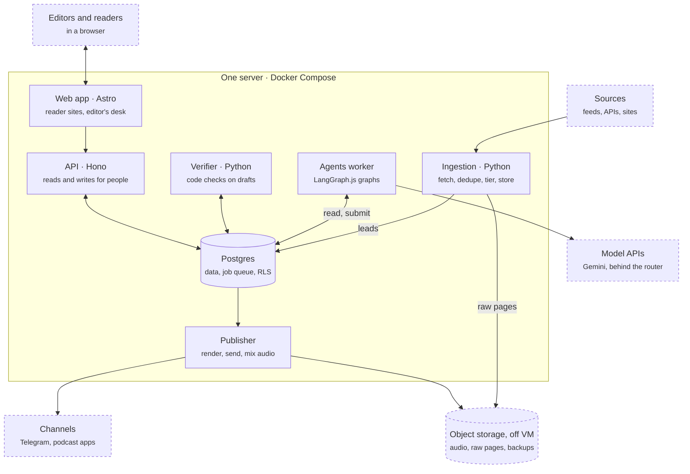
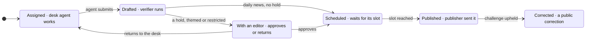

# ANR technical design

Oct 26, 2026 · Mehrad Rousta

ANR v1 runs on one server, the operator's laptop: Postgres holds every newsroom's data and the job queue, TypeScript runs the API, sites, publisher and agents, and Python runs ingestion and the verifier. Agents run as LangGraph.js graphs that can read stored sources and submit drafts, and nothing else; where each piece stands lives in Postgres, never in a graph.

## Stack

| Layer                   | Choice                                                                                                                             | Why                                                                                                                                                              |
| ----------------------- | ---------------------------------------------------------------------------------------------------------------------------------- | ---------------------------------------------------------------------------------------------------------------------------------------------------------------- |
| Host                    | The operator's laptop, Docker Compose, Caddy for TLS and wildcard subdomains                                                       | No hosting cost; v1 is one operator and a few newsrooms                                                                                                          |
| DNS and TLS             | Cloudflare DNS for the root domain; Caddy (custom build with the Cloudflare DNS module) issues one wildcard certificate via DNS-01 | Newsrooms are added without touching TLS                                                                                                                         |
| Database                | Postgres 17, row-level security on `newsroom_id`                                                                                   | Tenancy enforced by the database, not by each query                                                                                                              |
| Migrations              | Plain SQL applied with dbmate                                                                                                      | Language-neutral, and row-level-security policies are SQL anyway                                                                                                 |
| Jobs                    | pg-boss on the same Postgres; its schema installed by a migration                                                                  | Cron, retries and singleton keys with nothing new to run                                                                                                         |
| API                     | TypeScript, Hono on Node, OpenAPI contract written first                                                                           | Same tools as the current API                                                                                                                                    |
| Sites and editor's desk | Astro, server-rendered on Node; one app routes by host, and text direction follows each page's language                            | Reader sites read Postgres live, so publishing needs no rebuild                                                                                                  |
| Desk sign-in            | Cloudflare Access in front of `desk.$ANR_ROOT_DOMAIN`; the app verifies the Access JWT and maps the email to a membership          | No passwords or sign-in code in ANR                                                                                                                              |
| Site search             | Postgres `pg_trgm` over text normalised by the SQL function `anr.normalize_text()`                                                 | Works for Persian and Turkish without a stemmer or another service                                                                                               |
| Agents                  | LangGraph.js graphs in one agents worker; Gemini models behind a model router and a fallback gateway (`@anr/models`)              | Explicit, testable steps; works across model vendors; an agent can use only the tools ANR writes for it                                                          |
| Ingestion               | Python service: httpx, feedparser, trafilatura                                                                                     | Python's feed and text-extraction libraries are the strongest                                                                                                    |
| Verifier                | Python service: the code checks, such as quote matching and source independence                                                    | Text matching and NLP libraries                                                                                                                                  |
| Templates               | LiquidJS, one template per format and channel kind                                                                                 | Logic-less, safe to keep in config                                                                                                                               |
| Audio                   | Inside the publisher worker: ffmpeg, and Gemini TTS with one job per segment                                                       | The current podcast pipeline, ported                                                                                                                             |
| Media and backups       | Cloudflare R2 (S3-compatible object storage) off the server                                                                           | Audio, raw source snapshots, and Postgres backups (continuous WAL archive with pgBackRest), so losing the server loses nothing; no egress fees for podcast downloads |
| Shared schemas          | JSON Schema as the source; zod and pydantic generated from it                                                                      | Format schemas are read by both languages                                                                                                                        |
| Repo                    | One monorepo: pnpm workspaces and Turborepo for TypeScript, a uv workspace for Python                                              | One `pnpm check` covers both languages                                                                                                                           |

The Python services expose internal HTTP endpoints; TypeScript jobs call them, so there is only one queue.

## Components



Services never call each other's data directly: each reads and writes Postgres, and pg-boss jobs in the same database move work along. Agents reach Postgres only through their four tools.

## Data model

Every tenant row carries `newsroom_id`, enforced by row-level security (see Tenancy), and references other tenant rows through composite foreign keys on `(newsroom_id, id)`, so no row can point into another newsroom. The entities follow the charter's vocabulary; Check, Post, Media, User and Membership, Agent run, Audit log and the audience counters are added here. Tables are named in the plural (`publications`, `checks`). A lead's stored text and the audit log cannot be changed once written; triggers refuse it.

| Entity                            | Key fields                                                                                | Notes                                                                                                          |
| --------------------------------- | ----------------------------------------------------------------------------------------- | -------------------------------------------------------------------------------------------------------------- |
| Newsroom                          | slug, languages (one primary), timezone, subdomain, policy                                | The tenant. Policy holds beats, source rules and tiers                                                         |
| User, Membership                  | user (email); membership = user, newsroom, role (Editor-in-Chief or editor)               | Who can sign in to the desk and approve. Every approval and edit goes to the audit log                         |
| Audit log                         | actor, action, entity, before, after, at                                                  | Also tells the publisher whether an editor changed a publication's text                                        |
| Channel                           | kind (site, Telegram, podcast feed), language, external id, encrypted credentials, status | Data, not config: set up in the editor's desk and stored in Postgres                                           |
| Beat                              | name, status: open, restricted or banned, IPTC Media Topics                               | Restricted beats always go to a human; banned ones are never assigned. The topics classify every lead and publication in the beat |
| Source                            | kind (RSS, API, site), url, publisher, tier 1–3, fetch interval, terms checked (date)     | Tier 1 = primary: a lab's own post, a filing, an artist's or label's own statement                             |
| Lead                              | source, canonical url (ninjs `uri`), headline, stored text (`body`), language, byline (`by`), first and version created, content hash, SimHash, raw page key, links, tier, summary, beats, requested by (agent run), fetched at, withdrawn (at, reason) | The lead pool. Claims cite the stored snapshot (text, hash, SimHash and raw page are frozen). A lead an agent requests from an unknown site gets tier 3. A lead later found withdrawn keeps its text and is skipped by search, assignments and the verifier (D78) |
| Lead sighting                     | lead, uri, source, match (original, same URI, same text, near-duplicate)                  | Every place a lead was seen; a syndicated copy is a sighting, never a second lead or a second independent source |
| Source fetch state                | source, ETag, Last-Modified, last fetch, status, error, consecutive failures              | Ingestion's own state, apart from the config-synced source row                                               |
| Source request                    | agent run, uri, requested at                                                              | One fetch an agent run asked ingestion for; the per-run cap counts these (D61)                               |
| Editorial cycle                   | starts, ends, theme, angle, status                                                        | One approved cycle per newsroom per period; the period comes from `planning` in `newsroom.yaml`                |
| Pick                              | cycle, series, week, three candidates, chosen, picked by, deadline                        | The weekly choice. With no pick by the deadline, that week's slot is skipped and the editor is told            |
| Assignment                        | cycle or pick (empty for daily news), series, slot, angle, leads                          | The unit of work an agent receives                                                                             |
| Story                             | assignment, summary, beat                                                                 | Format- and language-neutral; researched once                                                                  |
| Claim                             | story, ref (c1, c2…), kind (fact, quote or opinion), text, lead, quoted passage; further sources (lead, passage) | Fact-checked once per source, however many languages the story appears in. Written in its lead's language (D77); further sources corroborate it (D74) |
| Rendition                         | story, format, language, structured body                                                  | Each item in the body lists the claim ids it relies on                                                         |
| Publication                       | series, slot, language, status, ordered renditions                                        | What goes out in one slot: an article, a newsletter issue or a podcast episode. The lifecycle below runs on it |
| Check                             | claim or rendition item, kind (code, fact-check, item match), result, detail              | Every check is stored, so a hold always has a reason                                                           |
| Post                              | publication, channel, part, external id, idempotency key, sent at                         | `part` numbers the messages of a split Telegram post                                                           |
| Media                             | file, source, IPTC Photo Metadata: creator, credit line, copyright notice, web statement of rights, licensor, digital source type; licence | The publisher refuses media without a licence                                                                  |
| Challenge, Correction             | publication, reader text, owner, acknowledge by, answer by, outcome                       | A correction links the check it adds                                                                           |
| Agent run                         | role, model, every family that answered, prompt version, input hash, tokens, cost, outcome, detail | Every model call is logged with its cost, TTS included; tokens and cost are summed over a run's calls. The fact-checker avoids every family of the story's desk and renderer runs |
| Notice                            | kind (budget warning, budget cap, no leads), key, detail, read at                          | A message from code to the Editor-in-Chief, once per period, shown in the editor's desk                        |
| Page view, Download, Channel stat | publication or channel, language, day, count                                              | Audience per language (see Measures)                                                                           |

Format and Series are configuration, versioned in the repo. Channels, users and memberships are data, managed in the editor's desk.

## Publication lifecycle



Each box is a value of a publication's `status`. A publication exists from the moment its assignment is made, so it starts as Assigned. Each arrow is a pg-boss job or an editor's action. An assignment whose agent fails validation twice also goes to an editor, and so does any publication still Assigned or Drafted 30 minutes before its slot (D80).

## Ingestion

Each source has its own pg-boss schedule, for example hourly for lab blogs and every 6 hours for arXiv. A source is scheduled only once a person has read its terms and set `terms_checked` in `sources.yaml`. A run calls the Python ingestion service, which turns new items into stored leads in this order:

1. **Fetch** the feed, API or page.
2. **Extract** the main text, and keep the raw page in object storage. The item's headline, byline, language and dates are kept under their ninjs names. For an image, the IPTC Photo Metadata embedded in its XMP is read into the Media row.
3. **Deduplicate** by canonical URL, then content hash, then near-duplicate text (SimHash candidates confirmed by shingle overlap, D56), so a syndicated copy joins the original's lead as a sighting and never counts as a second source.
4. **Tier.** Other leads take their source's tier. arXiv papers follow the paper tier rules (D59), mapped onto tiers: high is tier 1, medium tier 2, low tier 3, and flagged papers are dropped. High needs Semantic Scholar's venue or citations, never the authors' own claim; preprints are medium.
5. **Store** the lead with its text. The text is frozen: claims quote this snapshot, never the live page.
6. **Summarise and classify** with the summariser agent: a short summary, and the newsroom beats the lead belongs to. A lead's IPTC subjects are its beats' Media Topics, so classification never invents a code.

When a desk agent requests a source, it runs through the same steps at once, and the agent gets the lead back (D61). Each arXiv run also asks arXiv for its record of the source's papers of the last 30 days and marks any it now calls withdrawn (D78).

Every fetch goes through one guarded client (D58): http and https only, every address public and checked at connect time, robots.txt honoured for pages (an API source follows its API terms instead, D64), a polite delay per host, conditional GET. Hacker News items are stored as metadata only (D60). The TypeScript `ingest-source` job and the Python service share one contract, the JSON Schemas `ingest-*` and `source-request*` in `packages/schemas` (D62).

## Agent runs

Each agent run is one pg-boss job that runs one LangGraph.js graph and ends with one submit. A graph never waits for a human: approvals, holds and schedules are rows in Postgres.

| Role         | Runs when                                                                      | Gets                                                                                         | Steps                                                       | Submits                                                                        | Default model                                                          |
| ------------ | ------------------------------------------------------------------------------ | -------------------------------------------------------------------------------------------- | ----------------------------------------------------------- | ------------------------------------------------------------------------------ | ---------------------------------------------------------------------- |
| Planner      | A newsroom's editorial cycle starts, for themes; every Monday for picks        | The last cycle's stats, lead pool trends, policy                                             | Review stats → find themes or candidates → write proposals  | 2–3 themes with angle and calendar, or three candidates for each weekly series | Gemini Pro                                                             |
| Desk         | An assignment's slot comes up                                                  | Assignment, format schema, style guide, stored text of its leads                             | Read → outline → draft → list claims with quotes → validate | Story, claims and the first rendition, as JSON                                 | Gemini Pro; Gemini Flash for newsletter issues                         |
| Renderer     | A story needs another format or language, or a podcast needs the week's script | The story and its claims, or the week's published renditions; the target format and language | Draft → validate                                            | One more rendition, items linked to claims; no new research                    | Gemini Flash                                                           |
| Fact-checker | A story's claims pass the code checks                                          | One fact claim and its quoted passage at a time                                              | Check each claim                                            | A verdict per claim: supported, partial or unsupported                         | Gemini Flash for stories Pro wrote; Gemini Pro for stories Flash wrote |
| Item matcher | A rendition passes the code checks                                             | One rendition item and the claims it lists                                                   | Compare                                                     | Match, or what the item says beyond its claims                                 | Gemini Flash                                                           |
| Summariser   | A new lead is stored                                                           | The lead's text                                                                              | One call                                                    | Short summary and the lead's beats                                             | Gemini Flash-Lite                                                      |

**Tools.** An agent can do only four things: read a lead, search its newsroom's lead pool (trigram word similarity over normalised text, D73), request a new source (ingestion fetches and stores it, then returns the lead), and submit. Source requests are capped per run, private and internal addresses are refused, and a lead from an unknown site gets tier 3, so an injected page cannot promote itself. It has no web access, no send and no other writes. Models are bound to the three research tools; code calls submit once a draft validates, in one transaction with the run's outcome and the jobs that follow.

**Daily news.** At a daily series' `assignment_at` (16:00 for the AI newsletter), code assigns that evening's slot the last 24 hours of summarised leads, best tier first, with one publication per language and a desk run (D81). The desk writes the story and its first rendition in the newsroom's primary language; a renderer run writes each other language from the story's claims (D77); then the gate runs.

**Model router.** Agents name a role, never a model. A router in the agents worker maps each role to an ordered chain of models from the catalog in `config/models.yaml`, and a newsroom can override it. Changing a model or vendor is a config change; the defaults in the table are Gemini. Each catalog model has a `family`, the weights whoever serves them. The fact-checker's chain drops every family that wrote the story, read from the story's desk Agent runs; config validation requires at least two families in it, so the writer never checks its own facts, even when another provider serves the same weights.

**Model gateway.** `@anr/models` calls a chain in order and records which model answered. A rate limit (429, quota), an outage (5xx, timeout), a retired model or a request too large for one model (413, D83) moves the call to the next model; a rate-limited model cools down for as long as the provider says (`Retry-After`, `x-ratelimit-reset-*`, Gemini's `RetryInfo`) or backs off from 1 minute to 1 hour (longer than the provider's hint when 429s repeat); a provider whose quota is per account (`shared_quota`) cools down as a whole; every call has a 120-second deadline (a provider's `timeout_s` may extend it) and writes at most 8,192 tokens, with a per-model `reasoning_effort` for OpenAI-compatible providers (D85); and published limits in the catalog stop calls before the provider refuses them. A bad key or a bad request fails at once. When the chain is exhausted the run ends as an error, so the publication is held. A run keeps the model that first answered unless it fails. For development, `ANR_MODELS=free` selects `config/models.free.yaml`: local models served by LM Studio first (D84), then free tiers of Gemini, Groq, OpenRouter, Mistral and NVIDIA NIM; `pnpm models:probe` checks each model with one tool call, and deploy refuses the free profile.

- **Validation.** A submit is checked against the format's JSON Schema, and against what a schema cannot say: cited leads were given or read in the run and are not withdrawn, each passage is in its lead's text, the beat is live, every item lists known claims (D77). An invalid one goes back to the graph once with the errors; a second failure holds the assignment.
- **Prompts.** A role prompt from the platform, plus the newsroom's style guide (its shared section and the target language's) and the format's guide, versioned in config. At most 5 KB in UTF-8 bytes, against today's 74 KB rulebook; the prompt version is a hash of the assembled text (D75).
- **Budgets.** Each format caps tokens per run (`run_tokens`); each newsroom has a monthly spend cap with a reserve for checks (`budget` in `policy.yaml`). At 80% the Editor-in-Chief is told; at the cap minus the reserve, writing runs do not start while the fact-checker and item matcher may spend the reserve. TTS and summaries count toward the cap; every model needs a price (D76, D82).
- **Logging.** Every run is an Agent run row: role, model, prompt version, tokens and cost.

## Verifier gate

The gate runs in four layers, and two of them use a model. Facts are checked once per story; each language's text is then checked against those facts. Every result is stored as a Check, so a held publication always shows why. A `gate` job per story runs the layers in order once every language is written, storing each result as it comes, so a retry resumes (D80).

1. **Code checks (Python verifier service).**
   - The draft matches its format schema.
   - Every claim names a lead in this newsroom, not withdrawn, and its quote (and each further source's) is found in that lead's stored text. Matching normalises text first: NFKC, zero-width non-joiners, Arabic and Persian ye and kaf, Persian digits, and Turkish case folding, then collapses whitespace. The same rules back the SQL function used by site search, and both are tested against one shared file of test vectors.
   - Each fact claim has two independent sources, or one tier-1 source. Independent means different publishers, after deduplication, counted over the claim's sources whose passage matched (D74).
   - No banned beat, in the story or any cited lead, and no cited lead not yet placed in beats; a restricted beat is marked for an editor.
   - Every item of every rendition lists its claim ids, and the numbers (and so dates) and Latin-script names in the item are in those claims; names in other scripts are the item matcher's (D79).
   - The AI-disclosure label is present in every channel template's output, rendered with the publisher's own renderer (`@anr/render`); the style lint for the rendition's language and the format's `checks.yaml` rules pass. A rule the verifier does not know is an error.
2. **Fact-checker (agents worker).** Each fact claim and each of its quoted passages go to the fact-checker once, whatever the number of languages, each in a fresh context. It never sees the draft or the writer's reasoning. It returns supported, partial or unsupported. Quotes are matched by code; opinions are labelled, not fact-checked. The model layers run only when every code check passed.
3. **Item matcher (agents worker).** For every rendition in every language, a cheap model checks that each item says no more than the claims it lists. This catches drift between languages.
4. **Policy (code).** Any failed, partial, errored or timed-out check holds the publication for an editor, and so does any check it needs that never ran. Themed publications, restricted beats and formats outside `auto_publish` always go to an editor. Daily news with every check passed is scheduled to publish.

After publishing, code picks a 10% random sample of auto-published publications for an editor to review. Each miss an editor finds becomes a new code check or a policy rule.

## Publishing

The publisher is a TypeScript worker. When an approved publication's slot comes up, it renders the publication and sends it to each of its channels, then records the post. No agent is involved.

- **Rendering.** Each format has one Liquid template per channel, filled from the rendition's structured body. Templates own the channel's limits, such as Telegram's 4,096-character cap and how a long post splits.
- **Idempotent send.** Before calling a channel, the publisher writes a Post row keyed on publication, channel and part. After the call it stores the channel's message id. A retry that finds a stored id skips the send. A send whose result is unknown is held for a human rather than sent twice. After a database restore, every slot already past due is held too, so nothing goes out again.
- **Channels in v1.**
  - Site: the piece's status becomes published, and the server-rendered site shows it at once.
  - Telegram: the Bot API, for newsrooms that have a Telegram channel.
  - Podcast RSS: the feed is generated from the database.
- **Podcast script.** The renderer writes the episode script as JSON. A news-recap segment is a conversation of host lines. A story segment is told as a narrative:
  - **Protagonists:** one to three people the story follows, each grounded in claims.
  - **Beats:** cold open, context, turning point, stakes, resolution, takeaway, each exactly once in that order (stakes and turning point may swap). The turning point and resolution name a protagonist.
  - **Narrator:** a third AI voice for scene-setting and transitions, alongside the hosts.
  - **Delivery directions:** an optional short hint per line, such as "hushed", passed to TTS as a style prompt.
  - **Sound cues:** sting, bed swell, bed out, pause or transition, mapped to the series' stock assets.
  Sources are paraphrased and attributed in speech, never read aloud as quotes. The verifier checks the arc, the protagonists' claims, and that cues and directions stay sparse.
- **Podcast audio.** Code then runs the current pipeline:
  1. Gemini TTS, with voices set per host, narrator and language in the series config, delivery directions as style prompts, one job per segment, cached by text, voice and direction.
  2. ffmpeg mix: jingles, a ducked music bed, the script's sound cues mapped to stock assets, and loudness normalised to −16 LUFS, encoded as MP3. Episodes contain no recorded-music clips.
  3. ID3 tags and chapters.
  4. Upload to object storage.
  5. Add the feed item, and send the episode to Telegram where the newsroom has a channel there.
- **Media.** v1 publishes images only with a recorded licence: an artist's or label's press kit that allows press use, or a free Wikimedia Commons licence, always with credit. The publisher refuses media without one.

## Tenancy and configuration

A newsroom is a folder of config in the repo plus its channels, which live in the database. Adding one is a pull request, a DNS record, and its channels set up in the editor's desk, which is exactly the v1 test.

```
config/
  models.yaml                providers, model catalog, role → chain of models
  models.free.yaml           the same for free tiers (ANR_MODELS=free, development only)
  formats/<format>/          shared by all newsrooms
    schema.json              the draft's JSON Schema
    templates/<channel>.liquid   one template per channel kind
    checks.yaml              format-specific code checks
    format.yaml              IPTC genre, ninjs type, tokens per agent run
    guide.md                 short writing guide for the agent
  formats/_partials/         partials shared by all templates, the disclosure label among them
  newsrooms/<slug>/
    newsroom.yaml            languages, timezone, subdomain, Editor-in-Chief, corrections owner, planning cycle
    policy.yaml              beats with their status and IPTC Media Topics, source rules, tiers, auto-publish, monthly budget
    sources.yaml             sources with kind, url, publisher, tier, interval and terms checked
    series/<series>.yaml     a named recurring output: format, languages, cadence, hosts, channel kinds
    style.md                 the newsroom's style guide, per language
```

- **Domains.** Every newsroom site is served at `<subdomain>.$ANR_ROOT_DOMAIN`, its primary language at `/` and other languages at `/<language>`. The editor's desk is at `desk.$ANR_ROOT_DOMAIN`.
- **Channels.** Channels are data, not config or environment. The Editor-in-Chief adds a site, Telegram channel or podcast feed in the editor's desk, per language. Credentials such as bot tokens are encrypted in Postgres with one platform key. A series names channel kinds and languages; the publisher looks up the matching channels at send time.
- **Environment.** The only secrets in the environment are the platform key, the Postgres passwords (superuser and the three roles), object storage keys, the backup encryption passphrase, the model API keys, and the Cloudflare DNS token Caddy uses for the wildcard certificate. Database URLs are built from the passwords. `.env.example` lists them.
- **People.** Editors sign in to the desk through Cloudflare Access; the app verifies the Access JWT on every request and maps the email to a membership. Each membership gives a role in one newsroom, and every approval and edit is written to the audit log. `newsroom.yaml` names the publicly accountable Editor-in-Chief and corrections owner, shown on the newsroom's corrections page.
- **Loading.** Config is validated in CI and synced to Postgres at deploy, with stable ids; removed items are soft-deleted, and pg-boss schedules are reconciled in each newsroom's timezone.
- **Isolation.** Each transaction sets the current newsroom with a transaction-local setting, so a pooled connection never carries it to the next request; a query with no newsroom set fails rather than returning rows. A migration role owns the tables and is under forced row-level security too; the app role is under forced row-level security, with check policies on writes. Jobs that span newsrooms, such as config sync and the publisher's sweep, run under a separate system role. CI fails if a tenant table has no policy.
- **Credentials.** A channel's credentials are sealed in the app with envelope encryption: a random data key per credential under AES-256-GCM, wrapped by the platform key and bound to the channel's newsroom and id.
- **Overrides.** A newsroom can override a format's templates or guide in its own folder, but not its schema or its checks.

## Deploy and backups

`infra/deploy.sh` checks the production `.env`, builds the images, applies the role passwords, checks that WAL reaches R2, and starts the Compose `prod` profile: migrations (as the migration role), then config sync (as the system role, after the tenancy check), then the apps. pgBackRest archives WAL to R2 at least every 5 minutes, takes a weekly full and a daily differential backup, keeps four full backups and encrypts them with a passphrase held outside the server. A restore goes into an empty volume and runs with archiving off; `infra/backup/restore-drill.sh` restores the latest backup onto a fresh machine and loads config into it, and `infra/backup/drill-local.sh` rehearses the whole cycle locally. Until milestone 6 is done, ANR runs only locally and nothing is deployed (D53).

## AI disclosure

Disclosure is built into the templates and checked by code, so no newsroom can turn it off.

| Channel  | Visible label                                                     | Machine-readable                                              |
| -------- | ----------------------------------------------------------------- | ------------------------------------------------------------- |
| Site     | A label on every piece, linking to the newsroom's AI policy       | `digitalSourceType` in the page's schema.org JSON-LD and in its ninjs twin |
| Telegram | A label line in every post template                               | None: Telegram carries no metadata                            |
| Podcast  | AI hosts and the narrator are named as AI in the intro and in each episode's notes | The label in the feed item; a signed C2PA manifest in the MP3 |
| Images   | A caption label                                                   | IPTC Photo Metadata in XMP and a signed C2PA manifest, both with the image's own recorded digital source type |
- **Source type.** A publication is IPTC `trainedAlgorithmicMedia` ("Created using Generative AI"). Once the audit log shows an editor changed its text, it becomes `compositeSynthetic` ("Composite including generative AI elements"), and the visible label reads "AI-made, edited by a person". IPTC's `compositeWithTrainedAlgorithmicMedia` means the reverse, human media edited with generative AI, so ANR never uses it. Machine-readable outputs use the full URI, `http://cv.iptc.org/newscodes/digitalsourcetype/<code>`; JSON-LD uses schema.org's matching `IPTCDigitalSourceEnumeration` member. The constants are in `packages/core/src/iptc.ts`.
- **Signing.** The publisher signs C2PA manifests with c2patool at publish time, using c2patool's built-in certificate. It is free and needs no key in the environment. Verifiers show the full manifest, with the signer marked as not on the C2PA trust list. An episode's manifest carries the publication's digital source type URI in its `c2pa.actions` assertion; an image's manifest carries the type recorded on its Media row, and none if the source image had none.

A rendition whose template output has no label fails the code checks.

## IPTC standards

ANR describes what it takes in and what it puts out with IPTC standards, so search engines, archives and other newsrooms can read it without ANR-specific code. The IPTC vocabularies are vendored in `packages/schemas/iptc/` (NewsCodes snapshots under CC BY 4.0, plus the ninjs 3.2 JSON Schema), refreshed by hand with `pnpm --filter @anr/schemas iptc`; config validation rejects unknown and retired codes.

| Standard                             | In: sources and leads                                                                                                           | Out: publications                                                                                                                                                            |
| ------------------------------------ | ------------------------------------------------------------------------------------------------------------------------------- | ---------------------------------------------------------------------------------------------------------------------------------------------------------------------------- |
| Media Topics (`medtop`)              | Each beat in `policy.yaml` lists its Media Topics; the summariser places a lead in beats, so its subjects are those beats' topics | The publication's beat topics, as full URIs: ninjs `subjects`, JSON-LD `about`                                                                                               |
| Genre (`genre`)                      | —                                                                                                                               | One genre per format in `format.yaml` (newsletter issue `genre:Summary`, classic article and podcast episode `genre:Feature`, artist story `genre:Profile`); a publication with an opinion item adds `genre:Opinion`. ninjs `genres`, JSON-LD `genre` |
| Digital Source Type (`digsrctype`)   | Read from an image's Photo Metadata and kept on its Media row                                                                   | A publication is `trainedAlgorithmicMedia`, or `compositeSynthetic` once an editor changed the text (see AI disclosure): ninjs and JSON-LD `digitalSourceType`, and an episode's C2PA manifest. An image keeps the type recorded on its Media row (in XMP, its C2PA manifest and its ninjs `associations` entry); when the source image had none, the field stays unset and is never guessed |
| Photo Metadata                       | Creator, credit line, copyright notice, web statement of rights, licensor and digital source type, read from the image's XMP      | The publisher writes the same fields, with the stored licence, into the XMP of every image it publishes                                                                     |
| ninjs 3.2                            | A lead keeps the fields of a ninjs item (`uri`, `headlines`, `bodies`, `language`, `by`, `firstCreated`, `versionCreated`)        | Every published publication has a ninjs 3.2 twin at its page URL plus `.json`, linked from the page with `<link rel="alternate" type="application/json">`; `type` comes from `format.yaml`, `pubStatus` is `usable`, and a correction publishes a new `version` |
| Trust indicators (`trustindicator`)  | —                                                                                                                               | ninjs `trustIndicators`: `editorialPolicy` links the AI policy, `correctionsPolicy` the corrections page, `factCheckingPolicy` the AI policy's section on how the verifier checks claims; a corrected publication links its notice with `correctedByResource`. In JSON-LD the publisher, a `NewsMediaOrganization`, carries the same links as `publishingPrinciples`, `correctionsPolicy` and `verificationFactCheckingPolicy`, and a corrected piece carries `correction` |

- **Reader pages.** Each publication page carries schema.org JSON-LD: `NewsArticle` for text formats and `PodcastEpisode` for audio, with `inLanguage`, `about`, `genre`, `digitalSourceType`, `author` and `publisher` set to the newsroom (a `NewsMediaOrganization`), and `editor` set to the Editor-in-Chief.
- **Labels.** IPTC publishes Media Topic and genre labels in English only. Codes are machine-readable; the reader-facing names in fa, en and tr are ANR's own, kept in the site's translations.
- **Channels unchanged.** Telegram carries no metadata, and the podcast RSS feed follows the podcast namespaces; the IPTC description of an episode is its ninjs twin and JSON-LD on the site.
- **Tests.** The publisher's ninjs output is validated against the vendored ninjs 3.2 schema, and its JSON-LD against the digital source type, genre and topic URIs of the publication.

## Measures

The charter's v1 measures come from data ANR already holds, plus three audience counters:

| Measure                          | Source                                                                                                                                                                          |
| -------------------------------- | ------------------------------------------------------------------------------------------------------------------------------------------------------------------------------- |
| Hold rate, sample misses         | Checks and the 10% review sample                                                                                                                                                |
| Corrections per 100 publications | Challenges and corrections                                                                                                                                                      |
| Editor minutes per week          | Audit log: time from opening to deciding in the desk                                                                                                                            |
| Cost per publication             | Agent runs, TTS included                                                                                                                                                        |
| Audience per language (site)     | Cookieless server-side page-view counts per publication and language                                                                                                            |
| Audience per language (podcast)  | Episode audio is linked through the site (`/a/<episode>.mp3`), which logs a download, deduplicated by a hashed IP and user agent per 24 hours, then redirects to object storage |
| Audience per language (Telegram) | A daily subscriber-count snapshot per channel from the Bot API                                                                                                                  |

## Build order

```mermaid
flowchart TB
  M1["1. Foundation<br/><small>Repo, Postgres schema with row-level security,<br/>pg-boss, config loader, CI, off-VM backups</small>"]
  M2["2. Ingestion<br/><small>Python ingestion service, leads, credibility tiers,<br/>summariser agent</small>"]
  M3["3. Desk and verifier<br/><small>Agents worker with the desk and fact-checker<br/>graphs; the verifier's code checks</small>"]
  M4["4. Publishing<br/><small>Publisher, reader site, Telegram, editor's desk<br/>with sign-in and channels, disclosure labels</small>"]
  M5["5. Planning and podcasts<br/><small>Planner agent, cycle themes, weekly picks,<br/>audio pipeline, podcast RSS, C2PA signing</small>"]
  M6["6. Safeguards and the second newsroom<br/><small>Challenges and corrections, the 10% audit sample;<br/>the second newsroom added as config</small>"]
  G1{{"Config loads, and a backup restores into a fresh database"}}
  G2{{"The AI newsroom's sources fill the lead pool"}}
  G3{{"A daily brief is drafted, then passes or is held with reasons"}}
  G4{{"Daily news publishes end to end on its own"}}
  G5{{"One editorial cycle runs from plan to published pieces"}}
  M7["7. Deploy<br/><small>The laptop as the server, reachable from the internet;<br/>backups off it</small>"]
  G6{{"v1 done: the second newsroom starts with no new code"}}
  G7{{"A backup restores onto a fresh machine"}}
  M1 --> G1 --> M2 --> G2 --> M3 --> G3 --> M4 --> G4 --> M5 --> G5 --> M6 --> G6 --> M7 --> G7
```



Each milestone ships something that runs, and the next one starts only after its gate passes. Milestones are gated, not dated. The task list for each milestone is in the [build plan](build-plan.md).
